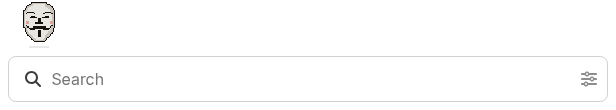

# Nautas Mascot

[ENGLISH](README.md) | **ESPAÑOL**

Mantenido por Criptonautas. Sin afiliación ni aval de Discourse (Civilized Discourse Construction Kit, Inc.).

Componente de tema para Discourse que pone a **anonist**, la mascota de la comunidad, en el buscador. Invita a preguntar más que a tipear palabras sueltas.

| En reposo | Buscador con foco |
|---|---|
|  |  |

El estilo `mask`: 

## Qué hace

anonist se para junto al buscador, por fuera y a 8 px de él (el buscador del banner le hace lugar encima), y se mueve en pasos, estilo 8 bits. El buscador conserva su lupa. Su buzo toma el tono medio del tema, así encaja en esquemas claros y oscuros.

| Cuándo | Cuadro |
|---|---|
| No pasa nada | respira (sube un píxel) y pestañea cada tanto |
| Al cargar y cada ~20 s, banner de bienvenida | camina sobre el buscador, en un piso tenue, y vuelve |
| Al cargar y cada ~20 s, encabezado | se para a la derecha del buscador sobre un piso tenue, salta tres pasos a la derecha, tres de vuelta y mira el buscador |
| El cursor está a un costado | mira hacia él |
| El buscador recibe foco | mira lo que escribes |
| Haces una pausa al escribir | asiente un píxel |
| La búsqueda está corriendo | piensa, con tres puntos que se encienden |
| Llegan los resultados | guiña |

Con `mascot_style` en `mask`, solo se ve su máscara, flotando: sube y baja sobre una sombra tenue, se desliza sobre el buscador del banner y vuelve, o va a la derecha y vuelve junto al del encabezado, con destellos mientras se mueve. Las caras de cada estado son las mismas.

Con *reducir movimiento* activado en el sistema, queda quieta y solo cambia de cuadro con cada estado.

## Ajustes

| Ajuste | Por defecto | Qué hace |
|---|---|---|
| `search_locations` | `header`, `welcome-banner` | Buscadores donde aparece la mascota |
| `mascot_size` | `48` | Tamaño en píxeles; 48 es el tamaño del dibujo |
| `mascot_style` | `figure` | `figure`: anonist completo, que camina y salta; `mask`: solo su máscara, flotando |

## Instalación

**Admin → Apariencia → Temas → Instalar → Desde un repositorio git**, con la URL de este repo. Después se agrega como componente del tema principal. [Cómo instalar un componente de tema](https://meta.discourse.org/t/how-do-i-install-a-theme-or-theme-component/63682)

## Licencia

Código: [MIT](LICENSE). El dibujo de anonist (los cuadros y `docs/`): [CC BY-NC-SA 4.0](CC-BY-NC-SA-4.0.txt), como el resto de los materiales de marca de Criptonautas.
